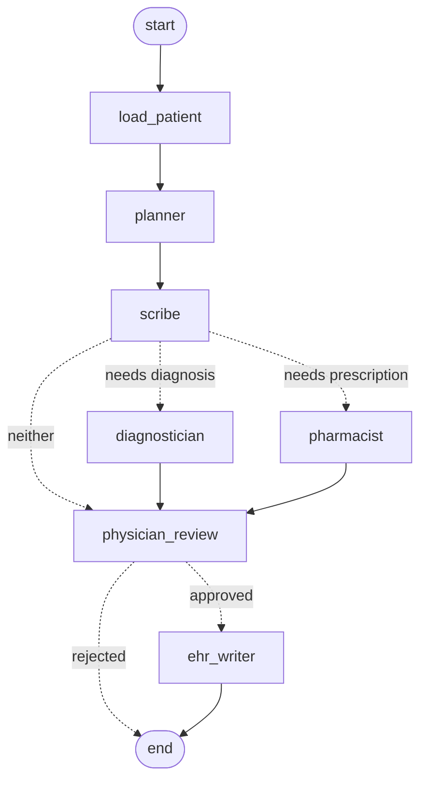

# Multi-agent workflow, planning, human in the loop and persistence

`src/mediscribe/workflow.py` orchestrates the agents with **LangGraph**: a graph whose nodes are agents
or steps and whose edges decide what runs next. Shared state flows through the graph.

| Node | Kind | Tools / model | Output |
|---|---|---|---|
| `load_patient` | deterministic | EHR MCP (read) | patient record |
| `planner` | LLM agent | Gemini, `WorkflowPlan` schema | which agents to run, red flags |
| `scribe` | LLM agent | Gemini, `SOAPNote` schema | draft note |
| `diagnostician` | LLM agent + tool | Gemini + terminology MCP | diagnoses with ICD-10-CM codes |
| `pharmacist` | LLM agent + fixed tool calls | Gemini + drug MCP | prescriptions with safety status |
| `physician_review` | **human** | `interrupt()` | approve / select / edit / reject |
| `ehr_writer` | deterministic | EHR MCP (**write**) | FHIR resources |

## Multi-agent design

Each agent has one job, its own versioned prompt (`prompts/<agent>/v1.txt`) and its own output schema.
Smaller, focused agents are easier to test and improve than one large prompt. The diagnostician and
pharmacist are independent, so LangGraph runs them **in parallel**; the review node waits for both.

## Planning and decisioning

Two kinds of decision exist in this workflow, on purpose:

- **LLM decides (flexible):** the planner reads the transcript and decides whether diagnosis and
  prescription agents are needed, and flags red flags. Conditional edges turn that plan into routing.
- **Code decides (fixed):** safety checks are not left to the model. A free-roaming ReAct agent was
  observed to skip the interaction check once the allergy check failed (see the tool-calling demo).
  The pharmacist node therefore always runs both the allergy and the interaction tool for every drafted
  prescription; the LLM only extracts the drafts.

Rule of thumb: let the model choose where judgement helps; hard-code steps whose omission is unsafe.

## Human in the loop

`physician_review` calls `interrupt(review_packet)`. The graph stops, and the packet (note, diagnoses,
prescriptions with safety findings, red flags, patient allergies) goes to the physician. The physician's
answer (`PhysicianDecision`) resumes the graph with `Command(resume=...)`.

Guardrails at this step:
- Nothing is written to the EHR before approval; `ehr_writer` is the only node with write tools.
- A prescription the safety check **blocked** is written only if the physician gives an **override reason**.
  Without one it is excluded automatically, and the exclusion is logged.
- Every step appends to an **audit trail** (who, what, when) that is stored with the workflow state.

## Persistence (checkpointing)

The graph is compiled with a **Postgres checkpointer**. After every node, the state is saved under a
`thread_id`. Because of this the review can happen later: the process can exit, the machine can restart,
and `--resume <thread-id>` continues exactly where it stopped. This is the workflow's short-term memory;
long-term patient memory lives in a vector database.

## Resilience: when the model is unavailable

Free-tier models are often overloaded (503) or out of quota (429), and models get retired (404).
The workflow degrades in layers instead of failing:

1. **Retry** each call with exponential backoff (`tenacity`).
2. **Fall back** to the next Gemini model in `GEMINI_FALLBACK_MODELS`.
3. **Switch provider**: Claude Haiku as the last resort (`CLAUDE_FALLBACK`), costing about one cent per consultation.
4. **Node retry policy**: LangGraph waits 20 s and runs a failed LLM node once more.
5. **Resume from checkpoint**: if a node still fails, the graph stops but every finished node is saved.
   `--resume <thread-id>` re-runs only the failed node (tested in `test_resume_after_failure_continues_from_checkpoint`).

The audit trail records which model answered each step, so a fallback is always visible.

## Testing without an LLM

`tests/test_workflow.py` replaces the LLM and MCP tools with fakes and checks routing, the pause, resume,
the override guardrail and rejection, with no network or API quota.
